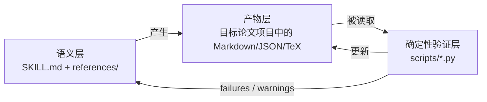

# 架构：证据链绑定、工作流与防幻觉机制

本文解释技能包如何把「一句主张」绑定到「可验证证据」，以及为什么失败会被显式暴露。所有事实锚定到源码；`路径:行号` 为本检出版本。

## 1. 三层架构



### 层 1：语义层（agent 侧）

- `SKILL.md` 声明入口路由、执行契约、闸门和证据边界（`SKILL.md:15-56`）。
- `references/` 按**领域**分层，不按编号：`README.md` 为入口地图，核心工作流为 `workflow.md` + `artifacts.md`，其余为 story / writing / literature / figure / citation / venue / reviewer / submission（`references/README.md:35-42`）。
- 该层产生**判断**：研究问题、主张强度、引用关系、图表信息、审稿风险。

### 层 2：产物层（目标论文项目）

核心机器状态与工件（`references/artifacts.md:5-67`）：

| 关注点 | 工件 |
|---|---|
| 机器状态 | `paper_state.json`（schema `ai-research-writing/paper-state-v1`） |
| 执行控制 | `plan/task-packets/<task>.md`, `plan/progress.md` |
| 证据清单 | `project_inventory.md`, `experiment_inventory.md` |
| 数值来源 | `numeric_evidence.json`（schema `numeric-evidence-v2`） |
| 主张绑定 | `paper_story.md`, `claim_evidence_map.md` |
| 文献 | `literature/paper_inventory.md`, `related_work_matrix.md`, `positioning.md` |
| 引用 | `references.bib`, `citation_verification.md`, `citation_requests.json`, `citation_lock.json` |
| 图表 | `figures/figure_plan.md`, specs/prompts, assets, plot scripts |
| 评审 | `reviewer_analysis.md` 或 `plan/review/`, `review.md`, `review_evidence.md` |
| 构建/投稿 | `build_check.md`, `submission_readiness.md`, `checklist.tex` |

### 层 3：确定性验证层（stdlib 脚本）

- 输入图解析与哈希：`scripts/paper_contract.py`。
- 数值溯源：`scripts/check_numeric_evidence.py`。
- 引用元数据与锁：`scripts/verify_citations.py`, `scripts/citation_lock.py`, `scripts/check_citation_lock.py`, `scripts/check_citations.py`。
- 总闸门：`scripts/research_quality_gate.py`。
- 构建证明：`scripts/record_build.py`。
- 辅助：`check_todos.py`, `parse_build_log.py`, `camera_ready_check.py`, `fetch_template.py`, `make_latex_table.py`, `extract_claims.py`, `check_research_handoff.py`。

## 2. 证据链 A：数字（numeric evidence v2）

### 2.1 绑定模型

```text
实验原始数据 (JSON/JSONL/CSV/TSV)
    │  selector {kind, pointer|column, where}
    ▼
_aggregate(values, aggregate)  ──►  recomputed value
    │  与 entries[i].value 按 tolerance 比较
    ▼
numeric_evidence.json  ──►  find_unverified_numbers()
    │                        扫描 Results/Experiments/... 与所有表格
    ▼
manuscript 数字  ──►  research_quality_gate.validate_paper()
```

关键实现（`scripts/check_numeric_evidence.py`）：

- `SCHEMA_VERSION = "ai-research-writing/numeric-evidence-v2"`（:19）；严格字段集 `ENTRY_FIELDS`（:21）、`SELECTOR_FIELDS`（:22）。
- `SELECTOR_KINDS = {"json-pointer", "jsonl", "csv", "tsv"}`；`AGGREGATES` 为 `identity/mean/sample-std/population-std/sum/min/max/count`（:23-24）。
- `_source_path()`（:69-81）拒绝路径逃逸到项目根之外，也拒绝把 JSON pointer 混进 `source` 字段（v1 写法必须显式迁移）。
- `_json_pointer()`（:84-97）实现 RFC 6901 风格指针（`~1`/`~0` 反转义）。
- `_selected_values()`（:104-174）按 selector 取数；`where` 用字符串相等匹配；拒绝 bool、非有限数、空选择。
- `_aggregate()`（:177-200）重新计算；`identity` 要求恰好一个值，`sample-std` 至少两个。
- `load_registry()`（:203-258）在加载时**就验证声明值与重算值一致**；`representations: ["raw","percent"]` 会生成原始值和 ×100 两个可接受值。
- `find_unverified_numbers()`（:270-302）屏蔽 `\cite...{}`、`\ref{}`、`\url{}`、`\begin/\end` 等（:41-48 的 `SKIP_RE`），追踪当前 section，只在 `STRICT_SECTION_TERMS`（:26-34：result/experiment/evaluation/ablation/analysis/finding/benchmark）或任何 `table/tabular/tabularx/longtable` 环境中审计数字。
- 结果结构 `NumericFinding(value, line, section, context)`（:61-66）；未登记数字 → 退出码 1（`main()` :310-341）。

### 2.2 为什么这能防幻觉

1. **重算而非信任**：注册表里的 `value` 必须与源数据重算结果一致，手写错数字在加载阶段就失败。
2. **覆盖面明确**：所有表格 + 结果类章节；不靠 agent 记得检查哪一节。
3. **容差显式**：默认 `1e-6`（`tolerance` 默认值见 :235），允许声明更宽的领域容差但必须写下来。
4. **格式感知**：`percent` 表示法允许论文写 91.2 而注册表写 0.912（:254-257）。
5. **失败即失败**：缺失源文件、非法 JSON、路径逃逸、无匹配行都是 `ContractError` → 退出码 2。

## 3. 证据链 B：引用（citation lock）

`references/citation-workflow.md:3-9` 把「verified」拆成三个独立维度：

1. 存在性与元数据（DOI/arXiv/官方记录）；
2. BibTeX 完整性（LaTeX key 与唯一条目）；
3. **句级 claim support**（这篇文献是否支持挂在它上的那句话）。

`check_citations.py` 只覆盖第 2 维（`citation-workflow.md:9`）。

### 3.1 请求与锁

`scripts/citation_lock.py` 定义：

- `REQUEST_SCHEMA = "ai-research-writing/citation-requests-v1"`, `LOCK_SCHEMA = "ai-research-writing/citation-lock-v1"`（:15-16）。
- 严格字段：`REQUEST_FIELDS`, `ENTRY_FIELDS = {key, identifier, claim_support}`, `SUPPORT_FIELDS = {claim, relation, status, evidence, source}`（:17-19）。
- `RELATIONS = {direct, background, contrast, software, partial, weak, metadata-only}`；终态支持状态 `SUPPORT_TERMINAL = {verified, software-doc}`；锁终态 `LOCK_TERMINAL = {verified}`（:20-22）。
- `canonical_digest()`（:25-27）：`json.dumps(sort_keys=True, separators=(",", ":"), ensure_ascii=True)` 后 SHA-256；所有摘要用同一函数，避免字段顺序造成假失败。

`load_requests()`（:30-88）逐项校验 key 唯一、`identifier` 以 `doi:`/`arxiv:` 开头、`claim_support` 非空、relation 合法。`validate_lock()`（:91-178）验证：

- 锁只含 `schema_version/request_sha256/records`；
- `request_sha256` 与当前请求一致（防陈旧锁）；
- 每条 record 的字段集合完全匹配（:119-125）；
- `metadata_sha256`、`claim_support_sha256`、`cross_check_sha256` 与重算摘要一致；
- identifier 未变；status 为 `verified`；provider/request_url/error 完整；`checked_at` 是带时区 ISO 时间，且不超过 `max_age_days`（默认 180，见 :97）；
- 每个 support 项状态为终态；
- LaTeX 中引用的 key 与 request/record 集合**双向一致**（:165-177）。

### 3.2 在线验证流程

`scripts/verify_citations.py`：

- `fetch()`（:31-44）把 HTTP 404/429/其他错误映射为 `not-found` / `rate-limited` / `provider-error` / `network-error`。
- `crossref()`（:57-76）为主 DOI 源；404 时 `datacite()`（:79-95）兜底；`arxiv()`（:98-117）解析 Atom API；`openalex()`（:120-138）为可选交叉核验。
- `comparable()`（:141-143）归一化标题（仅字母数字、casefold）、年份、DOI；任一项冲突 → `status = "conflict"`（:189-193）。
- 元数据不完整或句级 support 非终态 → `metadata-only`（:184-196）。
- **fail-closed**：无论成功失败都写 `citation_lock.json`（:218-219），但退出码只在全部 `verified` 时为 0（:220-225）。网络错误不会被静默当作“查无此文”。

### 3.3 总闸门里的引用检查

`research_quality_gate.py`：

- `validate_verification_table()`（:205-233）要求 `citation_verification.md` 有 Key/Status 列，所有 cited key 都有终态记录（`verified` / `software-doc` / `repository-verified`），且没有 open status 行；`verified` 行还会进入 scholarly 集合。
- 终态且存在 scholarly key 时，必须同时有 `citation_requests.json` 和 `citation_lock.json`，并执行 `validate_lock()`（:367-381）。

## 4. 状态机与总闸门

### 4.1 模式

`research_quality_gate.py:31-38`：

- `VALID_MODES = {"draft", "full-paper", "submission", "skill"}`；论文状态只允许前三种。
- `TERMINAL_STAGES = {"complete", "submission-ready"}`。
- 若根目录同时有 `SKILL.md` 和 `references/`，未指定 `--mode` 时自动推断为 `skill`（:450-451）；`validate_skill()`（:102-164）检查 frontmatter 仅 `name`/`description`、本地引用存在、README 链接可解析、脚本可编译、模板清单合法、无 vendored 模板目录。

### 4.2 `validate_paper()` 判定顺序（:267-436）

1. 读取 `paper_state.json`；requested mode 与 state mode 冲突即失败。
2. 校验 `schema_version`、未知字段、字符串字段、`blockers` 类型。
3. 基线工件：`paper_story.md`, `claim_evidence_map.md`, `citation_verification.md`, `build_check.md`, `plan/progress.md`；submission 额外要求 `submission_readiness.md`（:325-329）。
4. `plan/task-packets/*.md` 至少一个（:330-332）。
5. 终态时 `plan/progress.md` 不得含 “verification planned/pending/待验证” 等措辞（`STALE_PROGRESS_RE` :50-53, :334-336）。
6. 终态时 claim map 不得含 `needs evidence`, `pending`, `unknown`, `unverified`, `placeholder`, `待核验`, `待补充`（`OPEN_STATUS_RE` :54, `validate_claim_map()` :236-250）。
7. 手稿检查：`UNRESOLVED_RE` 捕获 TODO/FIXME/PLACEHOLDER/公式占位等；`PROCESS_RE` 捕获泄漏进正文的过程指令（如 “写作要求”“图位”“请用户”）（:39-49, `validate_manuscript()` :253-264）。
8. 数字、引用、构建：见上文与 `record_build.py`。

**退出码语义**：`main()` :439-472 返回 0（pass）、1（failures）、2（项目目录不存在）。

### 4.3 Build attestation

`scripts/record_build.py`：

- `--run`：`shlex.split(build.command)`，禁止 shell 操作符（:42-47）；在 `main_tex.parent` 执行，默认超时 300s（:21, :49-56）；写日志（`$ command`, stdout, stderr）并记录 `log_sha256`、`exit_code`、工具 `--version` 第一行、`attestation = "executed"`、`ran_at`（:57-87）。
- 失败时把 `status = "failed"` 写回 state 再抛错（:73-76）。
- 无 `--run` 时标记 `artifact-only`，`exit_code = None`（:88-94）；样例即采用这一模式。
- 输入集来自 `paper_input_files()`：所有 `\input/\include` 递归 TeX、所有 `\includegraphics` 解析后的图形、bibliography（paper_contract.py:59-95, :122-128）。
- 检查 PDF 不早于任何输入（mtime，:97-106）。
- `input_sha256 = digest_files(root, inputs, external_records)`：按**项目相对路径 + NUL + 文件字节 + NUL** 顺序更新 SHA-256；外部输入记录排序后追加（paper_contract.py:131-151）。
- `submission-ready` 额外要求 `attestation == "executed"`（research_quality_gate.py:400-401）。

## 5. 防幻觉机制总表

| 风险 | 机制 | 实现 |
|---|---|---|
| 凭空数字 | v2 注册表重算 + 结果章节/表格扫描 | `check_numeric_evidence.py` |
| 凭空引用 | 在线元数据验证 + 双哈希请求锁 + 双向 key 核对 | `verify_citations.py`, `citation_lock.py` |
| 引用与句子无关 | 七种 relation + 句级 `claim_support` 摘要 | `citation_requests.json`, `validate_lock()` |
| 未验证就宣布完成 | 终态 stage + blockers + stale progress + build 哈希 | `research_quality_gate.py` |
| 过程说明混进论文 | `PROCESS_RE` / `UNRESOLVED_RE` | `research_quality_gate.py:39-53,253-264` |
| 生成图冒充数据 | 图类二分：`evidence-result` 只能确定性 plot/table；`concept-method` 才用生成图 | `references/figure-workflow.md:24-45`, `figure-spec.md:49-57` |
| 隐藏负面结果 | 上游 handoff 明令不得 summarize away；blocker 必须继承 | `references/research-handoff.md:39-43` |
| 文稿“看起来完成” | reviewer 三镜头 + 六维自评 + rejection-risk 审计 | `references/reviewer-self-review.md:16-40,98-109` |
| 模板来源不明 | 官方来源清单 + SHA-256 + 拒绝 symlink/路径穿越 | `scripts/fetch_template.py:22-33,57-105` |

## 6. 已知边界（不要误认为是保证）

- 脚本不能判断一句自然语言是否**科学上正确**；引用句级关系仍需人/agent 阅读原文。
- `check_citations.py` 只查 key 与重复项（`check_citations.py:26-43`），不做元数据核验。
- `camera_ready_check.py` 是静态检查（章节、作者元数据、checklist 文件、marker、图形解析），不代替真实编译（`camera_ready_check.py:14-52`）。
- 质量门的 draft 模式若无 `paper_state.json`，要求项目内**恰好一个** `main.tex`（`research_quality_gate.py:288-295`）。
- `numeric_evidence.json` v1 不兼容，必须显式迁移（`references/numeric-evidence.md:35-36`）。
- 样例 `paper_state.json` 的 build `attestation` 是 `artifact-only`；`complete` 允许它，`submission-ready` 不允许。

## 7. 扩展时的不变量

1. 新/schema 改动必须同时更新：`references/*.schema.json`、对应脚本的字段集合、`tests/test_quality_tools.py`、本文与 `modules_reference.md`。
2. 新参考文件必须在 `SKILL.md` 路由表与 `references/README.md` 地图中登记，且相对链接必须存在（`research_quality_gate.py:118-132`）。
3. 新脚本必须保持：stdlib-only、失败的声明输入显式报错、退出码 0/1/2 语义清晰，并登记到 `scripts/README.md` 与 CI（`.github/workflows/quality.yml:22-41`）。
4. 任何「放宽检查」的改动都要说明它对应的科学风险；不要用删除断言来让门禁变绿。
