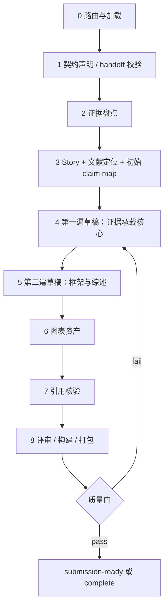

# 阶段流程与数据流：从代码/实验日志到 LaTeX 投稿包

本文描述**在目标论文项目中**执行的完整流水线。技能仓库只提供规则与脚本；所有论文工件写在用户的项目目录（`references/artifacts.md:3`）。

## 0. 总览



对应 `references/workflow.md:5-69` 的 8 个阶段。任何阶段失败时：**弱化主张、补证据、或写入 blockers**，不得跳过（`workflow.md:3`）。

## 1. 阶段 0：路由与最小加载

输入：用户请求。动作：

1. 从 `SKILL.md:15-27` 选择最小路由；
2. 打开 `references/README.md` 确认加载顺序；
3. 若是小任务（只做一节/一次引用修复），使用最小工件集（`references/artifacts.md:56-67`），不创建全套 state。

输出：明确的「请求类型 → 参考文件 → 允许修改的文件」清单。建议先写一份符合 `references/task-management.md:5-19` 的 task packet（scope、inputs、allowed files、rejection checks、validation commands、acceptance）。

## 2. 阶段 1：契约声明与上游交接

### 2.1 普通路径

- 探测 target venue、模板、匿名模式、主 `.tex`、参考文献、页数/checklist 约束与论文阶段（`workflow.md:5-10`）。
- 创建 `paper_state.json`（模板见 `references/artifacts.md:9-28`）、一个 task packet、`plan/progress.md`。
- 尽早执行 `python3 <skill>/scripts/research_quality_gate.py <paper-project>`，让缺失输入提前暴露。

### 2.2 有上游研究系统时

若存在 `research_handoff.json`：

```bash
python3 <skill>/scripts/check_research_handoff.py <handoff-project> --require-unblocked
```

实现要点（`scripts/check_research_handoff.py`）：

- `SCHEMA_VERSION = "ai-research-writing/research-handoff-v1"`（:14）；根字段严格集 :15-23。
- 基础工件 `project_inventory`, `analysis`, `decision`；`quantitative: true` 时**额外必需** `experiment_inventory` 与 `numeric_evidence`（:75-80）。
- `_artifact_path()`（:36-48）拒绝路径逃逸、不存在或空文件；文本工件必须 UTF-8 可读（:82-85）；`numeric_evidence` 走 `load_registry()` 重算验证（:86-87）。
- `--require-unblocked` 时 blockers 非空 → 退出码 1（:109-117）。
- 上游负责导出**证据**；本技能接手后拥有全部论文决定，且不得把上游写作 prompt 复制进技能契约（`references/research-handoff.md:39-43`）。
- blockers 必须原样继承到 `paper_state.json`；探索性写作允许带 blocker，但终态不允许。

## 3. 阶段 2：证据盘点

输入：代码、README、笔记、实验日志、CSV/JSON、notebook、已有草稿、图、bib、issue/TODO。

动作（`workflow.md:12-16`, `references/paper-story.md:22-40,54-66`）：

1. 生成/更新 `project_inventory.md`（仓库地图、方法证据、实验证据、写作资产、引用资产、缺失输入）。
2. 有实验时生成 `experiment_inventory.md`（benchmark、任务设定、baseline、metric 与方向、主数字、方差/种子、caveat、支持的 claim）。
3. 区分**证据**与**意图**：roadmap 条目不能写成已完成的贡献。

输出：可引用的事实清单与缺口清单。数字进入下一阶段的 `numeric_evidence.json` v2。

## 4. 阶段 3：Story、文献定位、初始 claim map

1. 按 `references/paper-story.md:5-21` 写出 `paper_story.md` 的 12 项；使用 Thesis Test（:68-76）、Contribution Test（:78-87）、Naming Test（:89-97）。
2. 主张强度分四级：strong / careful / aspirational / forbidden（:150-157）；在 story 与 claim map 中统一使用。
3. 生成 `claim_evidence_map.md`。可用启发式脚本起步：

   ```bash
   python3 <skill>/scripts/extract_claims.py paper/main.tex > claim_evidence_map.md
   ```

   `extract_claims.py` 的 `CLAIM_RE`（:15-24）匹配 propose/introduce/outperform/first/novel/SOTA 等词；`extract_target_text()`（:73-89）默认只读 Abstract + Introduction（`--sections` 可改），完全靠规则，**输出每行初始状态为 `needs evidence`**（:122-128）。它只是脚手架，必须人工补证据与改写。
4. 文献定位：`literature/paper_inventory.md`、`related_work_matrix.md`、`positioning.md`（`references/literature-review.md:9-19`）。引用流程见阶段 7。

## 5. 阶段 4–5：两遍草稿

### 5.1 第一遍：证据承载核心（`workflow.md:24-35`）

顺序固定：

1. 临时 title + abstract（只用于约束范围，不当终稿）；
2. Method / System Design；
3. Experiments / Evaluation；
4. Results、ablations、failure analysis、limitations；
5. 与这些章节绑定的图和表。

长论文建议**每个编号块一次 bounded 调用**：输入 story、claim map、相关证据、已完成的前序章节；禁止顺带重写无关章节。

### 5.2 第二遍：框架与综合（`workflow.md:37-44`）

1. Related Work（来自文献矩阵与已核验语料）；
2. Introduction（来自最终 gap、method、evidence）；
3. Conclusion（来自已证明结果与限制）；
4. **最后**重写 title 与 Abstract；
5. 全文术语统一 + reverse-outline。

写作细则见 `references/section-writing.md` 与 `references/abstract-introduction.md`；Abstract/Introduction 的每条强主张必须在 claim map 中有行（`abstract-introduction.md:5-7`）。

## 6. 阶段 6：图表资产

### 6.1 先写 plan/spec

- `figures/figure_plan.md`：每个图记录 class、role、message、entities、relationships、layout、backend、fallback（`references/figure-workflow.md:9-22`）。
- 复杂项目用 `figure-spec.md:9-34` 的 YAML：包括 `evidence_hierarchy`、`caption_takeaway`、`evidence_status`、`reviewer_risk`。

### 6.2 后端二分（不可混用）

| 类别 | 允许后端 | 禁止 |
|---|---|---|
| `evidence-result`（数值、消融、benchmark、heatmap） | `deterministic-plot` / `latex-table`；保留源数据与脚本 | **禁止**图像生成模型画精确数字 |
| `concept-method`（overview/method/pipeline/architecture/teaser） | `generated-image` 或 `hybrid` 为默认 | TikZ/SVG 仅作可选参考或生成失败时的 fallback |

依据：`figure-workflow.md:24-45`、`figure-spec.md:49-57`、`SKILL.md:45`。概念图的六段 prompt 结构见 `figure-workflow.md:118-129`；caption 四步法见 :169-183。

### 6.3 表格生成

```bash
python3 <skill>/scripts/make_latex_table.py results.csv \
  --caption "Main results." --label tab:main \
  --columns method,accuracy --precision 2 --bold max --bold-columns accuracy \
  --output paper/tables/main.tex
```

`build_table()`（`scripts/make_latex_table.py:59-91`）输出 `booktabs` 表格；`latex_escape()`（:23-24）转义 `& % $ # _ { }`；`choose_bold_values()`（:44-56）按列取 max/min 加粗。

## 7. 阶段 7：引用核验

### 7.1 六步流程

`references/citation-workflow.md:36-45`：segment → discover → resolve → verify metadata → read for support → record。

标识符合法性路由（:13-21）：DOI 优先 Crossref/注册机构并用 OpenAlex 交叉核验；arXiv ID 用官方 API；纯标题先 OpenAlex/Semantic Scholar 发现再回主标识；软件/数据集用官方 repo/docs。

### 7.2 机器流程

1. 将每个学术引用写入 `citation_requests.json`（schema `references/citation-requests.schema.json`）：`key`, `identifier`（`doi:`/`arxiv:`）, `claim_support[]`（claim/relation/status/evidence/source）。
2. 在线验证并写锁定文件：

   ```bash
   python3 <skill>/scripts/verify_citations.py <paper-project> --mailto you@example.org
   # 可选二次核验：OPENALEX_API_KEY=... 或 --openalex-api-key ...
   ```

3. 离线复核（CI 可用）：

   ```bash
   python3 <skill>/scripts/check_citation_lock.py <paper-project> --max-age-days 180
   ```

4. 内部 key 一致性：

   ```bash
   python3 <skill>/scripts/check_citations.py paper/main.tex paper/references.bib
   ```

   退出码 1 表示缺失 key 或重复 bib 条目；unused 仅提示（`check_citations.py:26-43`）。

`citation_verification.md` 必须包含 Key/Status 表；终态 key 状态必须是 `verified`, `software-doc` 或 `repository-verified`（`research_quality_gate.py:205-233`）。BibTeX 用结构化元数据生成，不从记忆敲写（`citation-workflow.md:88-94`）。

## 8. 阶段 8：评审、构建、打包

### 8.1 评审

两轮（`workflow.md:60-65`）：先 task/spec compliance，再 skeptical paper-quality review；质量轮用 methodology、domain/positioning、statistics/evidence 三个镜头，合并重复意见（`references/reviewer-self-review.md:16-26`）。高风险项转成 edit / experiment / citation / limitation / blocker；不要整篇重生，除非 story 本身改变。

### 8.2 数字与标记检查

```bash
python3 <skill>/scripts/check_numeric_evidence.py <paper-project>
python3 <skill>/scripts/check_todos.py paper/main.tex paper/references.bib paper/tables paper/figures
python3 <skill>/scripts/parse_build_log.py paper/main.log
python3 <skill>/scripts/camera_ready_check.py paper/main.tex --checklist paper/checklist.tex
```

- `check_todos.py` 扫描 `MARKER_RE`（TODO/FIXME/TBD/XXX/PLACEHOLDER/CITATION NEEDED 等，`check_todos.py:42-45`），跳过 `.git`, `.venue-template`, `node_modules` 等目录（:12-23），支持 `--allow` 正则白名单（:74-79）。
- `parse_build_log.py` 的 `PATTERNS`（:11-19）提取 errors/emergency/undefined citations/undefined refs/overfull/underfull/missing files；前五类命中即退出码 1（:56-57）。

### 8.3 真实构建与证明

```bash
python3 <skill>/scripts/record_build.py <paper-project> --run
# 仅当确实无法编译时才使用 artifact-only（record_build.py 无 --run）
python3 <skill>/scripts/research_quality_gate.py <paper-project>
```

注意：

- `build.command` 必须是单个 argv 序列（禁止 `|`, `&&`, `;`, `>` 等 shell 操作符），工作目录是 `main_tex.parent`（`record_build.py:42-52`）。
- 日志写到 `build.log`（默认 `<main_tex 目录>/build-attestation.log`），并记录 `log_sha256`, `exit_code`, `tool_version`, `ran_at`。
- 若 PDF 早于任何输入（TeX、图形、bib），拒绝记录（`record_build.py:97-106`）。
- `submission-ready` 必须 `attestation == "executed"` 且 `exit_code == 0`（`research_quality_gate.py:398-407`）。

### 8.4 模板获取

```bash
python3 <skill>/scripts/fetch_template.py --list
python3 <skill>/scripts/fetch_template.py icml2026 --output <paper-project>/.venue-template
```

下载器检查 manifest 中 pinned SHA-256，拒绝已存在输出目录、绝对路径/`..`/symlink 归档成员（`fetch_template.py:22-33,53-100`）。哈希不匹配时**不要绕过**，重新审计官方包并更新 manifest。

### 8.5 投稿包收尾

- 填写 `submission_readiness.md`（模板见 `references/submission-packaging.md:77-95`）与 venue checklist。
- 更新 `plan/progress.md`：完成检查、剩余科学风险；终态不得写 “verification planned/to be recorded/待验证”。
- 最终回复必须包含：修改的文件、运行的检查、构建状态、剩余 blocker、commit/push hash（如执行）（`submission-packaging.md:108-116`）。

## 9. 数据流总表

| 输入 | 中间工件 | 消费者 | 验证器 |
|---|---|---|---|
| 仓库代码/笔记 | `project_inventory.md`, `experiment_inventory.md` | story、Method | handoff checker / 人工 |
| 日志/CSV/JSON | `numeric_evidence.json` | Results 数字 | `check_numeric_evidence.py`, quality gate |
| story 素材 | `paper_story.md`, `claim_evidence_map.md` | 各章节草稿 | quality gate（终态 status） |
| 文献 | `references.bib`, `citation_verification.md`, `citation_requests.json`, `citation_lock.json` | Related Work | `check_citations.py`, `check_citation_lock.py` |
| 图/表源 | `figures/figure_plan.md`, specs, `.tex` tables | LaTeX | `resolve_graphics()`, `camera_ready_check.py` |
| 草稿 TeX | `main.tex` + `\input` 图 | PDF | `parse_build_log.py`, `record_build.py` |
| 全部上述 | `paper_state.json`, `plan/progress.md` | completion gate | `research_quality_gate.py` |

## 10. 本地端到端回归样例

仓库 CI（`.github/workflows/quality.yml:22-41`）本身就是可执行参考：

```bash
python3 -m unittest discover -s tests -v
python3 -m py_compile scripts/*.py
python3 scripts/research_quality_gate.py . --mode skill
python3 scripts/research_quality_gate.py examples/paper-about-ai-research-writing-skill
python3 scripts/check_citations.py \
  examples/paper-about-ai-research-writing-skill/paper/main.tex \
  examples/paper-about-ai-research-writing-skill/paper/references.bib
python3 scripts/check_todos.py \
  examples/paper-about-ai-research-writing-skill/paper/main.tex \
  examples/paper-about-ai-research-writing-skill/paper/references.bib \
  examples/paper-about-ai-research-writing-skill/paper/tables \
  examples/paper-about-ai-research-writing-skill/paper/figures
```

样例目录的 `paper_state.json` 展示了 complete 阶段所需字段；`build_check.md`、`citation_verification.md`、`claim_evidence_map.md` 是可对照的成品形态。
